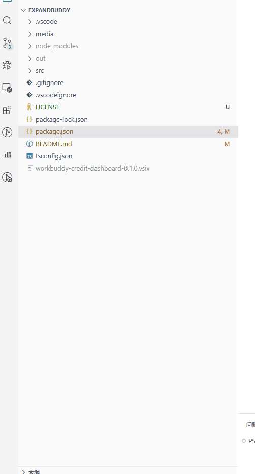

# WorkBuddy Credit Dashboard

**不用离开编辑器，随时掌握你的 WorkBuddy 积分。**

一个 VS Code / CodeBuddy 编辑器扩展，在侧边栏可视化展示积分余额、每日消耗明细与签到状态。所有数据都来自 WorkBuddy 官方接口，真实、不造假。

[](https://github.com/yangbaichao/credits_buddy)
[](LICENSE)
[](https://code.visualstudio.com/)




> 演示动图：`media/demo.gif`（录屏后取消上方注释即可展示）；界面截图：`media/screenshot-dashboard.png`。

## 为什么需要它

WorkBuddy 的积分、额度和签到信息散落在网页里。这个插件把它搬进你每天待着的编辑器：写代码的同时，状态栏就能看到剩余积分，侧边栏点开就能看余额、查消耗、一键签到——不用再切浏览器、不用再登网页。

## 功能亮点

- **一眼看清积分**：总额度 / 已用 / 剩余，配环形可视化图；状态栏常驻剩余积分。
- **消耗明细可下钻**：柱状图展示每日消耗，点击任意柱子展开当天每一笔请求的时间、模型、内容摘要与积分数；支持今天 / 近 7 天 / 近 30 天 / 本月 / 上月 / 自定义范围。
- **签到不切窗口**：看板内直接完成今日签到，按钮靠右、状态清晰。
- **一次授权，长期复用**：官方网页 OAuth 登录，令牌存入 SecretStorage 并做本地备份；需要时可一键退出。
- **按你的习惯排布**：卡片可拖拽排序，顺序本地保存；自动刷新间隔可配置或关闭。
- **真实数据**：不含任何演示数据；接口失败时明确提示，不伪造数值。

## 安装

从 VSIX 安装：

1. 在 [GitHub Releases](https://github.com/yangbaichao/credits_buddy/releases) 下载最新的 `.vsix`（或从源码执行 `npm run package` 生成）。
2. 在编辑器扩展视图选择「从 VSIX 安装」，或命令行：

```powershell
& "C:\...\CodeBuddy CN\bin\code.cmd" --install-extension .\workbuddy-credit-dashboard-0.1.0.vsix
```

安装后点击活动栏的「WorkBuddy 积分看板」图标，按提示完成一次授权即可。

## 隐私与安全

- 访问令牌仅保存在本机编辑器的 SecretStorage，并写入扩展私有存储作为备份；不写入明文配置、不上传到任何第三方服务器。
- 所有数据直接通过 WorkBuddy 官方接口读取；除「手动签到」外，扩展不会执行任何写操作。
- 若浏览器已登录 WorkBuddy 导致授权页不再弹扫码，可在无痕窗口打开授权链接重新扫码确认。

## 数据源

扩展通过 WorkBuddy 官方网页 OAuth 获取访问令牌：

1. `POST /v2/plugin/auth/state?platform=workbuddy` 获取授权地址
2. 在浏览器完成登录后，`GET /v2/plugin/auth/token?state=...` 换取令牌
3. 使用令牌调用：

   - `POST /billing/meter/get-user-resource-summary`（积分余额摘要）
   - `POST /v2/billing/meter/checkin-activity-status`（签到状态）
   - `POST /billing/meter/get-user-request-usage`（消耗明细，按天聚合）
   - `POST /v2/billing/meter/get-user-resource`（额度包明细，当前模块暂隐藏）

区域设置：

- `cn`（默认）：`www.workbuddy.cn`
- `global`：`www.codebuddy.cn`

## 设置项

| 设置 | 默认值 | 说明 |
| --- | --- | --- |
| `workbuddyCredit.region` | `cn` | 账号区域 |
| `workbuddyCredit.refreshInterval` | `5` | 自动刷新间隔（分钟），0 为关闭 |

## 本地开发

```bash
npm install
npm run compile
```

在 VS Code / CodeBuddy 中打开本目录，按 `F5` 启动 Extension Development Host，命令面板执行 `WorkBuddy: 打开积分看板`。

打包：`npm run package`，生成 `workbuddy-credit-dashboard-0.1.0.vsix`。

## 已知限制

- OAuth 授权需要用户在浏览器完成一次登录，后续会话会自动复用
- 消耗明细接口对单次查询时间跨度有上限（超过约 31 天返回空），扩展内部已按 30 天分段查询后合并，用户无感知
- 「额度包明细」模块暂时隐藏，相关代码保留以便后续恢复

## 许可证

[MIT](LICENSE)
